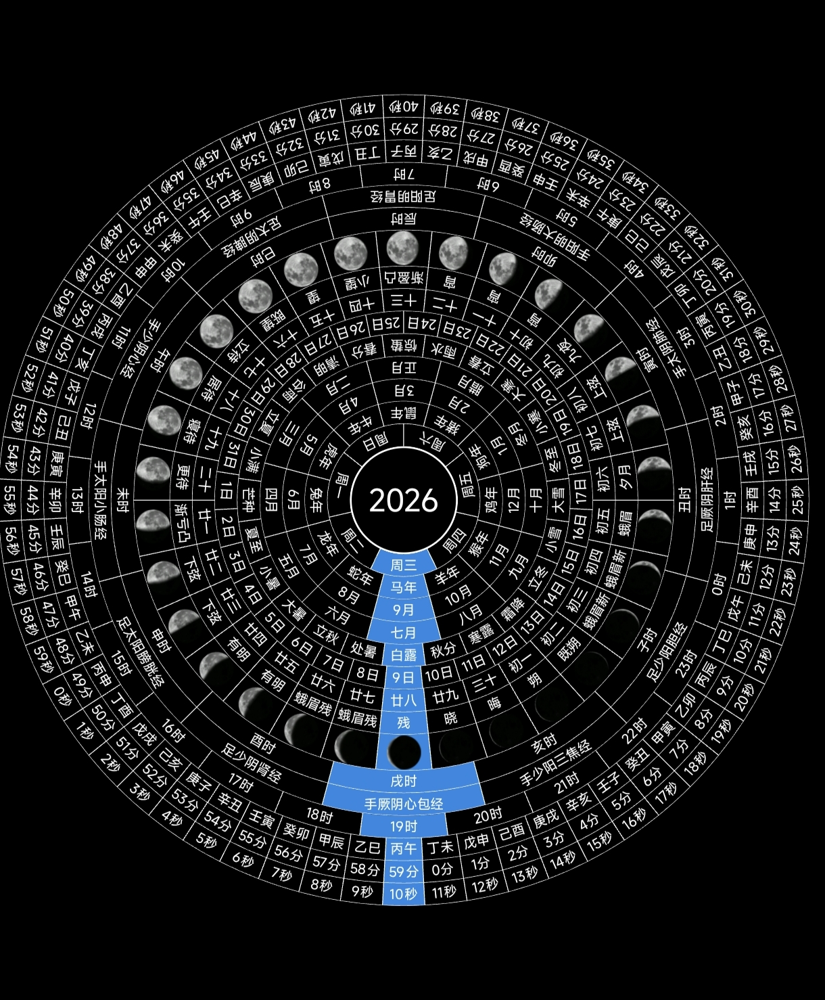

# 时间罗盘 · TimeCompass

一款 Windows 动态屏保：以「十五层罗盘」呈现中国传统时间体系——公历、农历、干支、
二十四节气、月相、十二时辰与子午流注，配星空流星背景与滴答声。



## 特性

- **15 层旋转环**：周/生肖/公历月/农历月/节气/公历日/农历日/月相名/月相图/时辰/经络/时/干支年/分/秒，
  当前格恒定落在正下方蓝色指示柱处。
- **时辰信息卡**：子午流注当令经络、宜忌、节气物候、月相亮度、四柱干支与农历日期，四角轮巡防烧屏。
- **背景**：深空 / 星空流星（Canvas，呼吸换位在"最暗瞬间"迁位，肉眼无感）/ 星云 / 极光 / 赛博网格。
- **防烧屏三件套**：李萨如轨迹亚像素漂移（47s×73s 互质周期，永不重合）、亮度呼吸、信息卡四角轮巡。
- **性能克制**：主循环 1Hz、星空与漂移按画质档位限速（eco/balanced/ultra），高刷屏不跟涨；
  实测帧间隔偏慢时自动减星。屏保模式空闲 CPU 约 0.1~0.4 核。
- **交互模式**：浏览器直接打开 `时间罗盘.html` 可缩放（滚轮）、3D 视差（鼠标）、暂停与自定义时间。

## 安装（终端用户）

1. 到 [**Releases**](https://github.com/hengletime/TimeCompass/releases) 下载最新版的
   `TimeCompass.scr`（自包含，内嵌 HTML，目标机器需有 Microsoft Edge）。
2. 右键 → **安装**（会复制进 System32 并打开屏幕保护程序设置），或复制到任意目录后
   在「设置 → 个性化 → 锁屏界面 → 屏幕保护程序」中选择它。
3. 双击 `.scr` 文件可直接全屏预览。

**退出**：动一下鼠标 / 按任意键 / `Ctrl+Alt+Q`（被占用时自动降级为
`Ctrl+Alt+Shift+Q`、`Ctrl+Alt+F12`、`Ctrl+Alt+F9` 之一）/ 万能保底 `Ctrl+Alt+Del`。

## 画质档位（可选）

在 `.scr` 同目录建纯文本「`时间罗盘.ini`」：

```ini
quality=eco        ; 80 星 / 12fps（省电）
quality=balanced   ; 130 星 / 20fps（默认）
quality=ultra      ; 200 星 / 30fps
```

## 受控电脑排查（公司电脑跑不起来？）

壳内置四条 Edge 启动策略（完整+私有配置 → 最小+私有配置 → 完整+系统默认 → 最小+系统默认）、
零磁盘写入的本地 HTTP 兜底通道、以及"弹窗即日志"的诊断（内存 ring buffer）。
若在企业管控/安全软件环境下启动失败，失败弹窗会列出每条策略的结局与可写判定结论。
配合 `屏保/TC-Diag.ps1`（在目标电脑一键测：本机写盘 / 安全软件清单 / Edge 位置 /
能否用私有 profile 跑 kiosk）可快速定位是哪一环在拦。最常见结论：
把 `TimeCompass.scr` 加入安全软件信任列表即可。

## 构建（开发者）

```bat
cd 屏保
构建屏保.bat          :: csc.exe 编译，内嵌上级目录的 时间罗盘.html
:: 或
python _build.py      :: 构建 + 全量硬校验（资源表/标记/源码级断言/陈旧产物检测）
```

自检工具（`tools/`）：`smoke.js`（HTML 五关自检，构建后必跑的 QA 门禁）。

## 目录结构

```
时间罗盘.html        罗盘页面（屏保与浏览器共用，#scr 进入屏保模式）
assets/             README 预览图
屏保/
  Scr.cs             屏保壳源码（C#，Edge kiosk 宿主 + 指针幕布 + 4 策略启动链）
  构建屏保.bat        一键构建
  _build.py          构建 + 硬校验
  TC-Diag.ps1        受控电脑一键诊断
tools/
  smoke.js           HTML 自检脚本
```

`.scr` 构建产物不入库，通过 [Releases](https://github.com/hengletime/TimeCompass/releases) 分发。

## 许可

仅供学习与个人使用。
